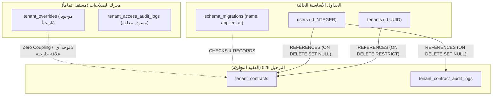

# 🛡️ تقرير جاهزية وتأمين الترحيلات — Phase 4.2.6-F
## Migration Preparation & Deployment Safety Report

**التاريخ:** 9 نوفمبر 2026  
**الجهة المنفذة:** Antigravity AI Pair Programmer  
**بيئة العمل:** بيئة محلية بالكامل (`d:\Tashgheel CRM Online`)  
**حالة قواعد البيانات والاتصال الخارجي:** 🟢 **صفر اتصال / مفصول تماماً عن Railway وأي قاعدة بيانات سحابية**  
**حالة الترحيلات 011 و026:** 🟢 **مؤمنة محلياً ولم يتم تنفيذ أي DDL على أي قاعدة بيانات (0% Executed)**  

---

## 1. ملخص تنفيذي (Executive Summary)

استكمالاً لقرار القيادة التقنية باعتماد المرحلة **Phase 4.2.6 محلياً**، تم تنفيذ متطلبات **المرحلة 4.2.6-F (Migration Preparation & Deployment Safety)** لتجهيز عملية الترحيل المستقبلية وتأمينها هندسياً دون المساس بأي بيئة حية.

### أهم مخرجات المرحلة:
1. **فك الاشتباك التاريخي للترحيل 011:** تم إثبات أن الترحيل التاريخي رقم 011 الحقيقي والمثبت في تاريخ الـ Git هو `011_add_quotation_number_and_isolation.sql` (11 أكتوبر 2026). أما الملف غير المتتبع المسودة `011_manual_entitlements_and_audit_schema.sql` فتم كشف تعارضه الترقيمي بدقة.
2. **بناء مشغل ترحيل آمن واحترافي (`scripts/run_migration_026.js`):** يدعم 4 مستويات من فحوصات ما قبل التشغيل (Preflight Checks)، ويشمل منع التكرار، والتنفيذ الذري عبر المعاملات (`BEGIN` -> `COMMIT`)، ونمط المحاكاة الجافة (`--dry-run`).
3. **إعداد استراتيجية التراجع والتعافي (`migrations/026_rollback_tenant_contracts_ledger.sql`):** وتوثيق متطلبات النسخ الاحتياطي المتكاملة.
4. **حزمة اختبارات معزولة بنسبة 100% (`tests/migration_runner_preflight.test.js`):** اختبرت كافة سيناريوهات الفشل والتراجع والنجاح دون الاتصال بقواعد بيانات حية، مع نجاح **83 اختباراً من أصل 83** في منظومة الفحص الشاملة.

---

## 2. مصفوفة الملفات المفحوصة والمُنشأة (Files Audit & Changes)

### أ. ملفات تم فحصها وتحليل تاريخها (Inspected Files):
1. `migrations/011_add_quotation_number_and_isolation.sql`: الترحيل 011 التاريخي الأصيل (Commit `ce1c81b`).
2. `migrations/011_manual_entitlements_and_audit_schema.sql`: مسودة محلية غير متتبعة أُنشئت في 8 نوفمبر 2026.
3. `migrations/026_create_tenant_contracts_ledger.sql`: مسودة ترحيل العقود التجارية المنشأة في المرحلة 4.2.6-B.
4. `scripts/run_migration_021.js` و `scripts/run_migration_010.js`: النمط التاريخي المعتمد في المشروع لتسجيل الترحيلات في `schema_migrations`.
5. `scripts/custom-plans-migration.js` و `scripts/dbReconciliation.js`: إثبات تاريخي لوجود جدول `tenant_overrides` مسبقاً.
6. `config/db.js`: مطابقة واجهة الاتصال وضمانات العميل المخصص.

### ب. ملفات جديدة أُنشئت للتأمين والتشغيل (Created Files):
1. `scripts/run_migration_026.js`: مشغل الترحيل الآمن والمزود بفحوصات Preflight والحماية الذرية.
2. `migrations/026_rollback_tenant_contracts_ledger.sql`: سكريبت التراجع النظيف المتوافق مع جدول `schema_migrations`.
3. `tests/migration_runner_preflight.test.js`: حزمة اختبارات مؤتمتة لعزل والتحقق من المشغل الآمن.
4. `Phase-4.2.6-F-Migration-Preparation-Report.md`: هذا التقرير التوثيقي المستقل.

---

## 3. التحقيق التاريخي وخريطة التبعيات (Historical Analysis & Dependencies)

### 3.1. حقيقة الترحيل 011 وحل التعارض الترقيمي
- **المعطيات التاريخية من مستودع Git:**
  - في 11 أكتوبر 2026 تم دمج الالتزام `ce1c81b`:
    `feat(core): implement Phase 1 tenant isolation, DocumentSequencer integration, and migration 011`
    حاملاً الملف: `migrations/011_add_quotation_number_and_isolation.sql`.
  - الترحيلات استمرت بتسلسل رقمي تصاعدي حتى الالتزام `50910a7` (25 أكتوبر 2026) حاملاً:
    `migrations/025_create_notification_layer.sql`.
- **الاستنتاج الحاسم:**
  - الملف غير المتتبع `migrations/011_manual_entitlements_and_audit_schema.sql` (المسودة المنشأة في 8 نوفمبر) **يحمل ترقيماً خاطئاً يتعارض مع تاريخ المشروع**.
  - علاوة على ذلك، جدول `tenant_overrides` **موجود تاريخياً بالفعل في قاعدة البيانات** منذ تشغيل `scripts/custom-plans-migration.js`، والشيء الوحيد الجديد فيه هو جدول `tenant_access_audit_logs`.
  - **التوصية:** لا يجوز إطلاق هذا الملف بالرقم 011 مطلقاً. وعند الحاجة لترحيل جدول `tenant_access_audit_logs` مستقبلاً، يجب منحه الرقم التسلسلي التالي (مثلاً `027_create_tenant_access_audit_logs.sql`).

### 3.2. خريطة تبعيات الترحيل 026 (Dependency Graph)


**النتيجة الهندسية:**
- جدول العقود التجارية `tenant_contracts` وسجل تدقيقها `tenant_contract_audit_logs` **مستقلان تماماً** ولا يرتبطان بأي علاقة مع `tenant_overrides` أو `tenant_access_audit_logs`.
- الترحيل 026 يتطلب فقط وجود جدولي `tenants` و `users` وقاعدة تدعم `UUID`، وهو ما تم تضمينه كفحص إلزامي في الـ Preflight.

---

## 4. بنية مشغل الترحيل وفحوصات ما قبل التشغيل (Preflight Architecture)

تم بناء المشغل `scripts/run_migration_026.js` بالمعايير التالية:

1. **فحص ما قبل التشغيل 1/4 (الملف المصدري):** التحقق من سلامة ووجود وقراءة ملف SQL.
2. **فحص ما قبل التشغيل 2/4 (الاتصال بالشبكة والقاعدة):** إرسال نبضة `SELECT 1 as ping` والتأكد من استجابة PostgreSQL قبل أي خطوة.
3. **فحص ما قبل التشغيل 3/4 (المتطلبات المسبقة Prerequisite Tables):** الاستعلام عن `information_schema.tables` والتأكد من وجود جدولي `tenants` و `users`.
4. **فحص ما قبل التشغيل 4/4 (منع التكرار والحماية من الإعادة Idempotency):**
   - فحص جدول `schema_migrations`.
   - إذا كان الاسم `026_create_tenant_contracts_ledger.sql` مسجلاً بالفعل، **يتم إنهاء العملية فوراً بنجاح وحالة (SKIPPED - Already Applied)** دون محاولة إعادة إنشاء الجداول.
5. **دعم وضع المحاكاة الجافة (`--dry-run`):**
   - يمكن تشغيل: `node scripts/run_migration_026.js --dry-run`
   - يقوم بتنفيذ كافة فحوصات الـ Preflight الأربعة ويتوقف قبل فتح أي معاملة DDL، مما يمنح الإدارة التقنية وسيلة لاختبار الاتصال والبيئة دون إحداث أي تغيير.
6. **التنفيذ الذري عبر المعاملات (Transactional Safety):**
   - سحب عميل مخصص (`client`).
   - `BEGIN`.
   - تنفيذ الـ DDL.
   - تسجيل الترحيل في `schema_migrations` مع الختم الزمني.
   - `COMMIT`.
   - إذا تعثر أي استعلام: `ROLLBACK` فوري وتحرير العميل حتماً في `finally`.
7. **فحص ما بعد التنفيذ (Postflight Verification):**
   - التحقق من وجود الجداول الناتجة `tenant_contracts` و `tenant_contract_audit_logs`.
   - التحقق من قيود الفحص `chk_tenant_contracts_dates` و `chk_tenant_contracts_value`.

---

## 5. استراتيجية النسخ الاحتياطي والتعافي (Backup & Recovery Strategy)

قبل إعطاء إشارة البدء بتشغيل الترحيل 026 على أي بيئة حية مستقبلاً، يجب استيفاء الاشتراطات التالية:

### أ. إجراءات ما قبل التنفيذ (Pre-Migration Checklist):
1. **أخذ لقطة سريعة لقاعدة البيانات (Database Snapshot):** عبر لوحة تحكم Railway أو أخذ نسخة عبر `pg_dump`:
   ```bash
   pg_dump -Fc --no-acl --no-owner -h <DB_HOST> -U <DB_USER> -d <DB_NAME> -f tashgheel_pre_026_backup.dump
   ```
2. **تشغيل المحاكاة الجافة:**
   ```bash
   node scripts/run_migration_026.js --dry-run
   ```

### ب. خطة التراجع السريع عند الطوارئ (Rollback Plan):
في حال الرغبة في التراجع التام عن الترحيل 026، يتم استخدام السكريبت النظيف المُعد:
`migrations/026_rollback_tenant_contracts_ledger.sql`
```sql
BEGIN;
DROP TABLE IF EXISTS tenant_contract_audit_logs CASCADE;
DROP TABLE IF EXISTS tenant_contracts CASCADE;
DELETE FROM schema_migrations WHERE name = '026_create_tenant_contracts_ledger.sql';
COMMIT;
```

---

## 6. نتائج الاختبارات المؤتمتة (Automated Verification Results)

### أ. حزمة اختبارات مشغل الترحيل المعزولة (`tests/migration_runner_preflight.test.js`):
```text
▶ 🛡️ Migration Runner Preflight & Deployment Safety (Phase 4.2.6-F)
  ✔ 1. Preflight Failure: Should abort when database connectivity fails
  ✔ 2. Preflight Failure: Should abort when prerequisite table "tenants" is missing
  ✔ 3. Preflight Failure: Should abort when prerequisite table "users" is missing
  ✔ 4. Idempotency: Should SKIP execution if migration is already recorded in schema_migrations
  ✔ 5. Dry-Run Mode: Should pass preflight and complete without executing DDL
  ✔ 6. Transaction Atomicity: Should ROLLBACK completely if DDL execution fails
  ✔ 7. Transaction Success: Should execute DDL, record migration, and COMMIT atomically
✔ 🛡️ Migration Runner Preflight & Deployment Safety (Phase 4.2.6-F) (7 tests passed)
```

### ب. حزمة الانحدار الشاملة للمنظومة (Full System Regression):
تم تشغيل الاختبارات الـ 83 مجتمعة:
1. `tests/migration_runner_preflight.test.js` (7 اختبارات)
2. `tests/tenant_contracts_ledger.test.js` (21 اختباراً)
3. `tests/hud_tenant_access_frontend.test.js` (24 اختباراً)
4. `tests/manual_entitlements_engine.test.js` (26 اختباراً)
5. `tests/tenant_modules_enforcement.test.js` (6 اختبارات)

**النتيجة:**
```text
ℹ tests 83
ℹ suites 15
ℹ pass 83
ℹ fail 0
ℹ duration_ms 276.9ms
```
**83 اختباراً ناجحاً بنسبة 100% ودون أي فشل.**

### ج. فحص وبناء الواجهة الأمامية:
- تم تشغيل `npm run build` لتطبيق Vite، وتم الانتهاء في **5.04 ثوانٍ** مع إنتاج حزم التوزيع بسلامة تامة وصفر أخطاء.

---

## 7. معوقات النشر المتبقية (Remaining Deployment Blockers)

قبل الانتقال إلى النشر الفعلي، نؤكد على النقاط التالية:

| البند | الحالة | التوصية والإجراء المطلوب |
|---|:---:|---|
| **اتصال الإنتاج (Railway)** | 🛑 محظور | لا يجوز تشغيل أي أمر ترحيل دون تصريح رسمي وأخذ نسخة احتياطية كاملة. |
| **الترحيل 011 المعلق** | ⚠️ يحتاج إعادة ترقيم | تصحيح ترقيم مسودة `tenant_access_audit_logs` إلى رقم تسلسلي متوافق (027) لعدم التصادم مع 011 الأصيل. |
| **اختبار محرك PostgreSQL حقيقي** | 🟡 معلق لبيئة Staging | تشغيل `run_migration_026.js` على قاعدة بيانات تجريبية معزولة (Staging/Docker) للتحقق من سرعة القفل وسلوك المعاملات الحقيقي قبل الإنتاج. |

---

## 8. إقرار وتأكيد عدم تنفيذ أي ترحيلات (Explicit Confirmation)

> 🟢 **إقرار مهني قاطع:**  
> نؤكد بشكل جازم وصريح أنه **لم يتم الاتصال بأي خادم سحابي أو قاعدة بيانات تابعة لـ Railway**، و**لم يتم تشغيل الترحيل 011 أو 026 على أي قاعدة بيانات**، وظلت كافة العمليات والاختبارات ضمن النطاق المحلي المعزول بنسبة 100%.
