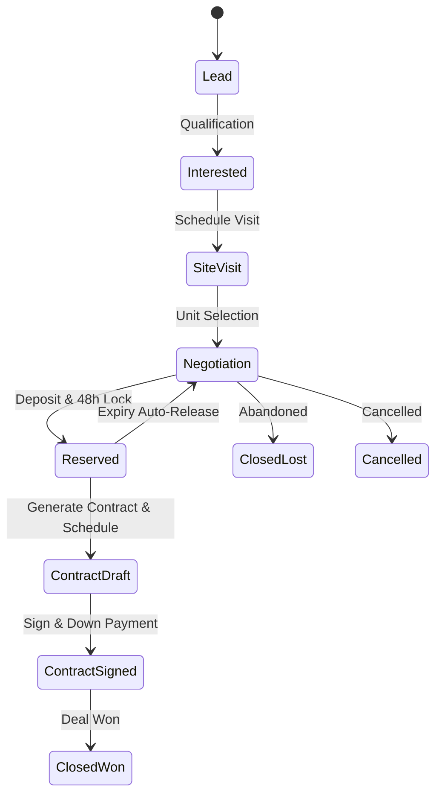

# Tashgheel CRM Online — Real Estate Module
# Business Rules & Lifecycle Governance Matrix

**Document Reference:** `RE-BUSINESS-RULES-MATRIX.md`  
**Date:** November 21, 2026  
**Auditor / Engineering Lead:** Real Estate Engineering & Platform Core Team  
**Branch:** `fix/real-estate-lifecycle-audit`  
**Status:** Ready for Business Decision & Architectural Sign-off  

---

## 1. Overview & Purpose

During the Real Estate functional audit, multiple observations stemmed from unformalized business definitions rather than code bugs. Enforcing arbitrary restrictions without stakeholder approval risks breaking existing customer workflows or conflicting with sales operations.

This matrix documents:
1. **Confirmed Rules:** Rules validated and enforced in code.
2. **Unresolved Rules:** Rules requiring business/executive sign-off, detailing implications, options, and engineering recommendations.

---

## 2. Business Rules Confirmation Status Matrix

| ID | Domain | Business Rule Statement | Status | Current Implementation | Action Required |
| :--- | :--- | :--- | :--- | :--- | :--- |
| **BR-RE-01** | Multi-Deal Linking | Multiple deals/leads can link to the same unit concurrently. | **CONFIRMED** | Permitted. Multiple leads can inquire about the same property. | None. Documented. |
| **BR-RE-02** | Reservation Exclusivity | A unit may have only **ONE** active reservation at any time. | **CONFIRMED** | Enforced via row lock `FOR UPDATE` in `reserveDealUnit` returning `409 Conflict`. | None. Enforced. |
| **BR-RE-03** | Reservation Ownership | Reservation badges, countdown timers, and extension actions belong strictly to the reserving deal. | **CONFIRMED** | Fixed in `Deals.jsx` (`isReservingDeal` check). Competing deals show info badge only. | None. Fixed. |
| **BR-RE-04** | Reservation Expiry | When a reservation expires, unit reverts to `Available`. Reserving deal transitions to `negotiation` with `is_unit_reservation = false`. | **CONFIRMED** | Implemented in `reservationService.scanAndReleaseExpiredReservations`. | Scheduled cron job active. |
| **BR-RE-05** | Reservation Extension | Extensions can be granted by Admins, Managers, or Assigned Agents (24h/48h). | **CONFIRMED** | Enforced via `reservationService.extendReservation`. | None. Enforced. |
| **BR-RE-06** | Contract Signing Impact | Signing a contract permanently moves unit to `Contracted` and clears reservation timers. | **CONFIRMED** | Handled in `reContractsController.js`. | None. Enforced. |
| **BR-RE-07** | Competing Deals on Contract | Competing deals linked to a contracted unit must be handled. | **PENDING** | Currently competing deals remain open in their stages. | **Decision Required** (Options below). |
| **BR-RE-08** | Deal `Closed Won` Prerequisite | Transitioning a deal to `Closed Won` requires an active/signed contract. | **PENDING** | Currently deals can move directly to `Closed Won` without a contract. | **Decision Required** (Options below). |
| **BR-RE-09** | Deal to Unit Cascade | Moving deal to `Closed Won` automatically marks linked unit as `Contracted`. | **PENDING** | Currently unit remains in previous state unless contract was created. | **Decision Required** (Options below). |
| **BR-RE-10** | Contract Dates & Term | Determining contract term when duration is specified without start date. | **PENDING** | Missing start date renders contract as "No term". | **Decision Required** (Options below). |
| **BR-RE-11** | Dashboard Metric Alignment | Canonical definition of Active Deals & Pipeline Value across all dashboard pages. | **CONFIRMED** | Standardized stage normalization across `dashboardService` and `salesManagementController`. | None. Fixed. |
| **BR-RE-12** | Commission Trigger | Sales commission earned upon deal `Closed Won` vs upon contract signing / down payment. | **PENDING** | Currently commissions can be generated manually upon contract creation. | **Decision Required** (Options below). |

---

## 3. Deep Dive on Unresolved Decisions & Engineering Recommendations

### 3.1 Competing Deals Lifecycle upon Contract Signing (BR-RE-07)
When Deal A contracts Unit U-102, what should happen to Deal B (also linked to U-102)?

- **Option A (Strict Automation):** Automatically set all other open deals linked to U-102 to `Closed Lost` with loss reason *"Unit sold to another buyer"*.
  - *Risk:* Prevents sales agents from offering alternative units to the interested buyer within the same deal context.
- **Option B (Recommended — Alert & Unlink):** Keep competing deals active, automatically clear their `unit_id`, append an activity log *"Unit U-102 was contracted by another deal. Please assign an alternative unit"*, and emit an in-app notification to the deal owner.
- **Option C (Passive Warning):** Leave competing deals untouched, but display an amber banner *"Linked unit is now contracted to another client"* when viewing the deal.
- **Engineering Recommendation:** **Option B.** Maximizes pipeline preservation while eliminating data inconsistency.

---

### 3.2 Deal Stage State Machine & Contract Prerequisites (BR-RE-08 & BR-RE-09)
Can a deal move to `Closed Won` without a formal contract in `re_contracts`?

- **Option A (Strict Enterprise Validation):** Hard-block stage transition to `Closed Won` unless a contract exists in `status = 'Signed'` or `'Active'`. If attempted without a contract, return `422 Unprocessable Entity` with message *"A signed real estate contract is required to close this deal as Won"*.
- **Option B (Recommended — Progressive Enforcement):**
  - If a deal has a linked `unit_id`, transitioning to `Closed Won` prompts a modal: *"Do you want to generate a Real Estate Contract now?"*
  - If skipped by an admin, the deal marks as `Closed Won`, and the linked unit is automatically updated to `Contracted`.
  - For standard sales agents, require a signed contract.
- **Option C (Unconstrained CRM):** Allow any deal to transition to `Closed Won` freely. Does not alter unit status unless manually edited.
- **Engineering Recommendation:** **Option B.** Balances governance with operational agility.

---

### 3.3 Contract Duration & Dates Handling (BR-RE-10)
How should `start_date`, `end_date`, and `duration_months` interact?

- **Option A (Enforce Start Date if Duration Entered):**
  - If `duration_months` is entered (> 0), `start_date` becomes a mandatory field (cannot be empty).
  - `end_date` is automatically calculated as `start_date + duration_months`.
  - The `end_date` field is rendered read-only or auto-populated.
- **Option B (Smart Defaulting — Recommended):**
  - If `start_date` is not provided, default `start_date` to the current date (`new Date().toISOString().split('T')[0]`) or contract signing date.
  - Automatically compute `end_date = addMonths(start_date, duration_months)`.
  - If both `start_date` and `end_date` are left empty, contract displays `Open Term` / `عقد مفتوح المدة` instead of the confusing `No term`.
- **Option C (Independent Fields):**
  - Make `start_date`, `end_date`, and `duration_months` entirely independent, disabling automatic computation.
- **Engineering Recommendation:** **Option B.** Eliminates null dates while accommodating users who leave start date blank.

---

### 3.4 Commission Entitlement Trigger (BR-RE-12)
When does a sales commission become payable?

- **Option A (Deal Closure):** Commission is recognized immediately upon deal transitioning to `Closed Won`.
- **Option B (Contract Signing & Down Payment — Recommended):** Commission is calculated upon contract signing and becomes payable only after the down payment installment is verified as `Paid`.
- **Option C (Installment Pro-Rata):** Commission is disbursed proportionally as installments are collected from the buyer.
- **Engineering Recommendation:** **Option B.** Aligns with standard MENA real estate brokerage and developer compliance practices.

---

## 4. Dashboard Metric Standard Definitions (BR-RE-11)

To prevent future discrepancies across UI surfaces, the following metrics are formally standardized:

| Metric Name | Canonical Definition | Stage Inclusions | Stage Exclusions |
| :--- | :--- | :--- | :--- |
| **Active Deals Count** | Count of all open deals currently in the sales pipeline for the tenant/branch. | `lead`, `interested`, `site visit`, `negotiation`, `reserved`, `contract draft` | `won`, `lost`, `cancelled`, `closed`, `closed won`, `closed lost`, `contracted` |
| **Active Pipeline Value** | Sum of deal values for all open deals currently in the sales pipeline. | `lead`, `interested`, `site visit`, `negotiation`, `reserved`, `contract draft` | `won`, `lost`, `cancelled`, `closed`, `closed won`, `closed lost`, `contracted` |
| **Closed / Won Deals Count** | Count of deals successfully finalized with buyer commitment. | `won`, `closed won`, `closed_won`, `contracted`, `closed` (where not lost) | All open stages, `lost`, `cancelled` |
| **Closed / Won Value** | Total contract/deal value of all successfully finalized deals. | `won`, `closed won`, `closed_won`, `contracted` | All open stages, `lost`, `cancelled` |
| **Reserved Pipeline Value**| Total value of deals currently holding active unit reservations. | Deals where `is_unit_reservation = true` or stage in `reserved` | Non-reserved open deals, closed deals |
