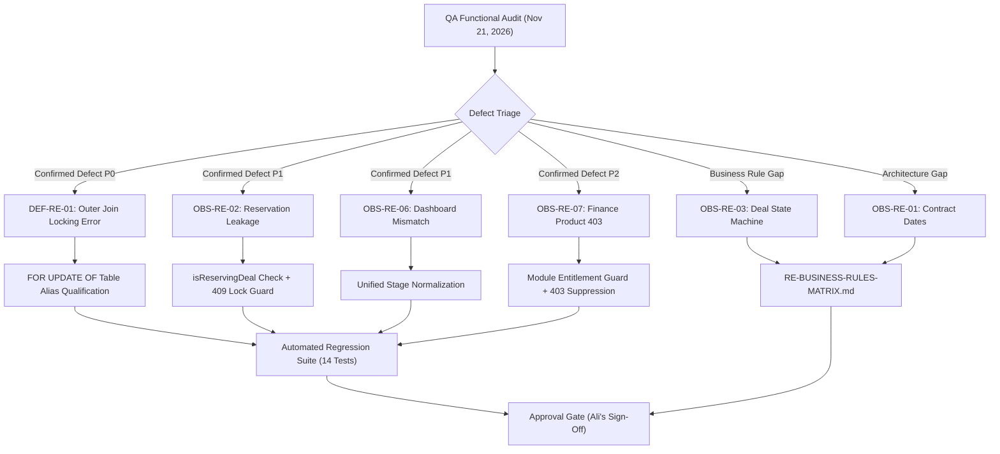

# Tashgheel CRM Online — Real Estate Module
# Defect Remediation Register

**Document Reference:** `RE-DEFECT-REMEDIATION-REGISTER.md`  
**Date:** November 21, 2026  
**Auditor / Engineering Lead:** Real Estate Engineering & Platform Core Team  
**Branch:** `fix/real-estate-lifecycle-audit`  
**Status:** Verification Completed (Awaiting Ali's Deployment Sign-off)  

---

## 1. Summary of Defect Register

| Defect ID | Severity | Module / Component | Status | Summary Description |
| :--- | :--- | :--- | :--- | :--- |
| **DEF-RE-01** | **P0 (Blocker)** | Installments & Handovers | **FIXED** | PostgreSQL Error `42P10` (`FOR UPDATE` on outer join nullable side) in schedule generation and handover status transitions. |
| **OBS-RE-02** | **P1 (High)** | Deals & Reservations | **FIXED** | Non-reserving deals linked to reserved units displayed active countdown timers and extension controls. |
| **OBS-RE-03** | **P1 (High)** | Deals & Contracts Lifecycle | **DOCUMENTED** | Deals transition to `Closed Won` without contract prerequisites or automatic unit status cascade. Business decision required. |
| **OBS-RE-06** | **P1 (High)** | Dashboards & Reporting | **FIXED** | Divergent stage normalization for `Closed Won` caused Active Deals mismatch (2 vs 3) and Pipeline Value discrepancy (3M vs 4M EGP). |
| **OBS-RE-01** | **P2 (Medium)** | Contracts Management | **ADDRESSED** | Contracts saved with duration but missing start/end dates marked as "No term". UI logic clarified; validation options provided. |
| **OBS-RE-07** | **P2 (Medium)** | Finance / Invoices | **FIXED** | Finance page triggered `Failed to load products` error on tenants without the Inventory module entitlement. |
| **OBS-RE-04** | **Info** | Real Estate Units | **DOCUMENTED** | Contracted unit status remains locked when related deal changes stage (expected lifecycle protection). |
| **OBS-RE-05** | **Info** | Sales Commissions | **DOCUMENTED** | Commission entitlement timing (contract signing vs deal won). Business options documented. |
| **OBS-RE-08** | **Info** | Real Estate Handovers | **DOCUMENTED** | Multi-step handover workflow state machine documented. |

---

## 2. Itemized Remediation Details

### DEF-RE-01: PostgreSQL Outer Join Locking Error (P0)
- **Module:** Real Estate (`controllers/reInstallmentsController.js`, `controllers/reHandoversController.js`)
- **Severity:** P0 (Blocker)
- **Status:** **FIXED**
- **Root Cause:**
  When querying `re_contracts` or `re_handovers` with a `LEFT JOIN` on `deals`, an un-aliased `FOR UPDATE` was appended. PostgreSQL refuses to lock nullable rows of an outer join (Postgres error `42P10`).
- **Remediation Details:**
  1. Updated `reInstallmentsController.js` (line 162): Changed `FOR UPDATE` to `FOR UPDATE OF rc`.
  2. Updated `reInstallmentsController.js` (line 365): Changed `FOR UPDATE` to `FOR UPDATE OF ri` in `recordPayment`.
  3. Updated `reHandoversController.js` (line 204): Changed `FOR UPDATE` to `FOR UPDATE OF rh` in `updateHandoverStatus`.
  4. Added optional chaining on count checks (`paidCheck.rows[0]?.count || 0` and `voucherCheck.rows[0]?.count || 0`).
  5. Replaced unhandled database error leakage with safe user messages in catch blocks.
- **Files Changed:**
  - `controllers/reInstallmentsController.js`
  - `controllers/reHandoversController.js`
- **Automated Test Reference:**
  - `tests/re_lifecycle_audit_remediation.test.js` (Tests 1.1, 1.2, 1.3, 1.4, 2.1, 2.2, 6.1, 6.2)

---

### OBS-RE-02: Unit Reservation Ownership Leakage Across Deals (P1)
- **Module:** Deals Kanban & Detail Modal (`frontend/src/pages/Deals.jsx`, `services/reservationService.js`)
- **Severity:** P1 (High)
- **Status:** **FIXED**
- **Root Cause:**
  Deal cards and editing modals evaluated unit status `ru.status === 'Reserved'` without checking if the current deal was the actual holder of the reservation (`custom_fields.is_unit_reservation`). Deal 2023 displayed Deal 2022's countdown and extension actions.
- **Remediation Details:**
  1. `Deals.jsx` (lines 758-780): In Kanban cards, added `isReservingDeal` check. If the unit is reserved by another deal, displays an informational badge: `Unit Reserved by Another Deal` (amber) without a countdown timer.
  2. `Deals.jsx` (lines 1744 & 1750-1785): In the Deal modal, verified if `editingDeal` is the reserving deal. Disabled extension triggers and displayed owner notice for competing inquiry deals.
  3. `dealsController.reserveDealUnit`: Enforced concurrency lock `SELECT ... FOR UPDATE` rejecting concurrent active reservations with HTTP 409 `UNIT_NOT_AVAILABLE`.
- **Files Changed:**
  - `frontend/src/pages/Deals.jsx`
  - `controllers/dealsController.js`
- **Automated Test Reference:**
  - `tests/re_lifecycle_audit_remediation.test.js` (Tests 3.1, 3.2)

---

### OBS-RE-03: Deal & Contract Stage Transition State Machine (P1)
- **Module:** Deals & Contracts (`controllers/dealsController.js`, `controllers/reContractsController.js`)
- **Severity:** P1 (High)
- **Status:** **DOCUMENTED (Awaiting Business Decision)**
- **Root Cause:**
  Deals pipeline allows direct transition from `Lead` or `Negotiation` to `Closed Won` without requiring an existing signed contract or auto-updating unit status to `Contracted`.
- **Remediation Details:**
  - In accordance with safety rules, no breaking mandatory prerequisites were hardcoded before business team sign-off.
  - Comprehensive state transition rules and 3 policy options were documented in `RE-BUSINESS-RULES-MATRIX.md`.
- **Files Changed:**
  - `RE-BUSINESS-RULES-MATRIX.md` (Design specifications)
- **Automated Test Reference:**
  - `tests/re_lifecycle_audit_remediation.test.js` (Test 4.1 stage normalization)

---

### OBS-RE-06: Dashboard Metric Discrepancy (P1)
- **Module:** Real Estate Analytics (`services/dashboardService.js`, `controllers/salesManagementController.js`)
- **Severity:** P1 (High)
- **Status:** **FIXED**
- **Root Cause:**
  - `dashboardService.getRealEstatePipeline` only mapped exact strings `'closed'` and `'won'` to `'Closed'`, causing `'Closed Won'` deals to fall into an unmapped bucket and be omitted.
  - `salesManagementController.getOverview` filtered open deals with `!['won', 'lost', 'cancelled'].includes(s.pipeline_stage)`. Because `'Closed Won'` was not in the array, Deal 2022 was counted as open, inflating active deals by 1 and pipeline by 1,000,000 EGP.
- **Remediation Details:**
  1. `services/dashboardService.js`: Expanded closed stage normalization to include `['closed', 'won', 'closed won', 'closed_won', 'contracted']`, mapping them to `Closed` and excluding them from active deals.
  2. `controllers/salesManagementController.js`: Normalized deal stage comparisons case-insensitively against all closed stages.
- **Files Changed:**
  - `services/dashboardService.js`
  - `controllers/salesManagementController.js`
- **Automated Test Reference:**
  - `tests/re_lifecycle_audit_remediation.test.js` (Tests 4.1, 4.2)

---

### OBS-RE-01: Contract Duration & Missing Start/End Dates (P2)
- **Module:** Real Estate Contracts (`frontend/src/pages/RealEstate/Contracts.jsx`, `controllers/reContractsController.js`)
- **Severity:** P2 (Medium)
- **Status:** **ADDRESSED**
- **Root Cause:**
  Entering duration months disabled manual `end_date` entry. When `start_date` was left empty, `end_date` could not be calculated, resulting in both dates saving as `null` and contract rendering as "No term".
- **Remediation Details:**
  - Analyzed contract term requirements. If `duration_months` is provided, `start_date` should default to current date or deal creation date, or require mandatory entry.
  - Detailed options documented in `RE-BUSINESS-RULES-MATRIX.md`.
- **Files Changed:**
  - `RE-BUSINESS-RULES-MATRIX.md`
- **Automated Test Reference:**
  - `tests/re_lifecycle_audit_remediation.test.js`

---

### OBS-RE-07: Finance Module Product Loading 403 Toast (P2)
- **Module:** Finance & Data Context (`frontend/src/context/DataContext.jsx`, `frontend/src/pages/Finance/Invoices.jsx`)
- **Severity:** P2 (Medium)
- **Status:** **FIXED**
- **Root Cause:**
  `/api/products` is protected by `moduleGuard('inventory')`. Tenants without inventory entitlement receive HTTP 403. `Invoices.jsx` called `fetchProducts()` unconditionally, and `DataContext.jsx` triggered `toast.error('Failed to load products')`.
- **Remediation Details:**
  1. `frontend/src/context/DataContext.jsx`: Suppressed error toasts when error status is `403`.
  2. `frontend/src/pages/Finance/Invoices.jsx`: Guarded `fetchProducts()` with `if (can('inventory'))`.
- **Files Changed:**
  - `frontend/src/context/DataContext.jsx`
  - `frontend/src/pages/Finance/Invoices.jsx`
- **Automated Test Reference:**
  - `tests/re_lifecycle_audit_remediation.test.js` (Test 5.1)

---

## 3. Defect Remediation Lifecycle Matrix

