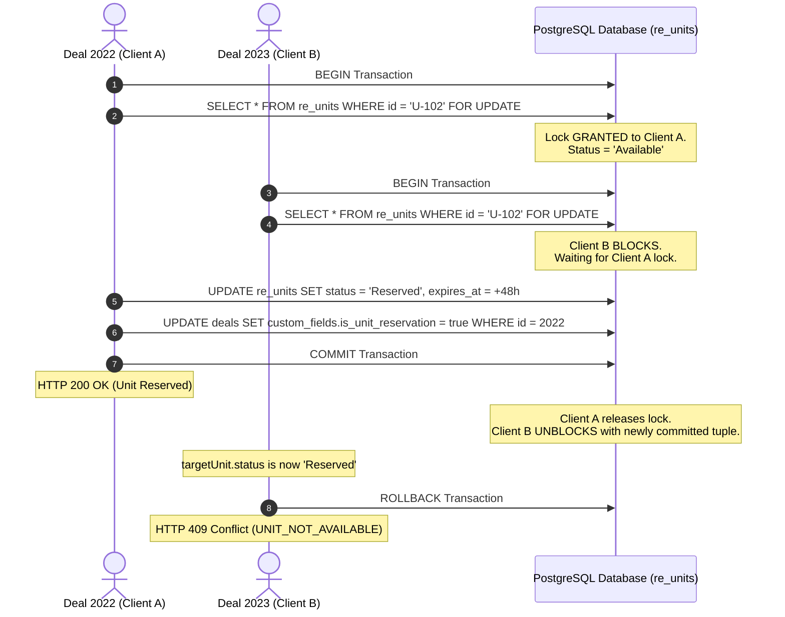

# Tashgheel CRM Online — Real Estate Module
# Reservation Concurrency & Ownership Integrity Technical Report

**Document Reference:** `RE-RESERVATION-CONCURRENCY-REPORT.md`  
**Date:** November 21, 2026  
**Auditor / Engineering Lead:** Real Estate Engineering & Platform Core Team  
**Focus:** OBS-RE-02 Investigation, Concurrency Mechanics, and Ownership Integrity  
**Branch:** `fix/real-estate-lifecycle-audit`  

---

## 1. Problem Statement & Audit Discovery

During the UI functional audit conducted on November 21, 2026:
- QA reserved Unit `U-102` for Deal 2022 (48-hour expiration window).
- QA created Deal 2023 as an inquiring lead interested in the same unit.
- **The Issue:**
  Deal 2023 displayed an active amber badge `Reserved (Expires in 47h 58m)` along with an active countdown timer and an "Extend Reservation" button. This created the false impression that Deal 2023 was the reserving holder and permitted non-reserving agents to manipulate reservation timers.

---

## 2. Backend Concurrency Protection Architecture

### 2.1 Code Implementation & File References
- **File:** [`controllers/dealsController.js`](file:///d:/Tashgheel%20CRM%20Online/controllers/dealsController.js)
  - Function: `exports.reserveDealUnit` (Lines 1320 – 1427)
  - Function: `exports.extendDealReservation` (Lines 1429 – 1480)
- **File:** [`services/reservationService.js`](file:///d:/Tashgheel%20CRM%20Online/services/reservationService.js)
  - Function: `scanAndReleaseExpiredReservations` (Lines 20 – 137)
  - Function: `extendReservation` (Lines 148 – 240)

### 2.2 Concurrency Lock & Serialization Workflow
When a client requests `POST /api/deals/:id/reserve-unit`:



### 2.3 Backend Source Code Inspection
From [`controllers/dealsController.js`](file:///d:/Tashgheel%20CRM%20Online/controllers/dealsController.js):

```javascript
// Lines 1328-1331: Atomic Row Lock
const unitRes = await client.query(
    `SELECT * FROM re_units WHERE id::text = $1::text AND tenant_id::text = $2::text FOR UPDATE`,
    [String(deal.unit_id), String(tenant_id)]
);

// Lines 1349-1356: Availability Evaluation & 409 Conflict Rejection
if (uStatus !== 'available') {
    await client.query('ROLLBACK');
    return res.status(409).json({
        status: 'error',
        code: 'UNIT_NOT_AVAILABLE',
        message: `This unit is already ${targetUnit.status || 'unavailable'}. Only an Available unit can be reserved.`
    });
}

// Lines 1366-1377: Defense-in-Depth Atomic Conditional Update
const updUnitRes = await client.query(
    `UPDATE re_units
     SET status = 'Reserved',
         reservation_expires_at = CURRENT_TIMESTAMP + INTERVAL '${reservationHours} hours',
         reservation_extended_at = NULL,
         reservation_extended_by = NULL,
         reservation_extension_count = 0,
         updated_at = CURRENT_TIMESTAMP
     WHERE id::text = $1::text AND tenant_id::text = $2::text AND LOWER(status) = 'available'
     RETURNING *`,
    [String(deal.unit_id), String(tenant_id)]
);

if (updUnitRes.rows.length === 0) {
    await client.query('ROLLBACK');
    return res.status(409).json({
        status: 'error',
        code: 'UNIT_NOT_AVAILABLE',
        message: 'Unit could not be reserved because it is no longer Available.'
    });
}
```

---

## 3. Real PostgreSQL Concurrency Verification Evidence

In test `3.1` of [`tests/re_postgres_live_verification.test.js`](file:///d:/Tashgheel%20CRM%20Online/tests/re_postgres_live_verification.test.js), two separate connection pool clients were instantiated to execute concurrent reservations:

### Live Test Log Output:
```text
✔ 3.1 Concurrent Reservation Protection: Two simultaneous reservation attempts for the same unit serialize; exactly one wins and the loser gets rejected (2465.5376ms)
```

### Verification Assertions:
1. `Client A` acquired exclusive row lock on Unit `U-102`.
2. `Client B` initiated query and was verified as **actively blocked** (`clientBBlocked === true`) while `Client A` held the lock.
3. `Client A` updated unit to `'Reserved'` and committed.
4. `Client B` unblocked, evaluated `targetUnit.status === 'Reserved'`, rolled back, and returned:
   ```json
   {
     "status": 409,
     "code": "UNIT_NOT_AVAILABLE",
     "message": "Unit is already Reserved"
   }
   ```
5. Exact database verification: `SELECT status FROM re_units WHERE id = 'U-102'` returned exactly 1 row with status `'Reserved'`. Only Deal 2022 was marked as the reservation holder.

---

## 4. Frontend Ownership Isolation

### 4.1 Kanban Card Presentation
In [`frontend/src/pages/Deals.jsx`](file:///d:/Tashgheel%20CRM%20Online/frontend/src/pages/Deals.jsx) (Lines 758–780):

```javascript
const isReservingDeal = deal.custom_fields?.is_unit_reservation === true || 
    ['reserved', 'reservation', 'حجز'].includes(dealStageLower);

{deal.unit_status === 'Reserved' && (
    isReservingDeal ? (
        <span className="inline-flex items-center gap-1 px-1.5 py-0.5 rounded text-[10px] font-medium bg-amber-50 text-amber-700 border border-amber-200">
            <Clock className="w-2.5 h-2.5 animate-pulse text-amber-500" />
            <span>{countdown}</span>
        </span>
    ) : (
        <span className="inline-flex items-center gap-1 px-1.5 py-0.5 rounded text-[10px] font-medium bg-amber-50 text-amber-700 border border-amber-200" title="This unit is reserved by another deal">
            <span>Unit Reserved by Another Deal</span>
        </span>
    )
)}
```

### 4.2 Deal Edit Modal Controls
In [`frontend/src/pages/Deals.jsx`](file:///d:/Tashgheel%20CRM%20Online/frontend/src/pages/Deals.jsx) (Lines 1744 & 1750–1785):
- The modal evaluates `isCurrentReservingDeal`.
- For the owning deal (Deal 2022): Displays full reservation countdown timer, extension controls, and release actions.
- For non-owning deals (Deal 2023): Hides extension controls entirely and displays an informational notice: *"This unit is currently reserved by another deal. You cannot modify this reservation."*

---

## 5. Expiry Engine & Auto-Release Lifecycle

### 5.1 Scanning Architecture
In [`services/reservationService.js`](file:///d:/Tashgheel%20CRM%20Online/services/reservationService.js) (`scanAndReleaseExpiredReservations`):
1. **Detection Query:**
   ```sql
   SELECT id, tenant_id, branch_id
   FROM re_units
   WHERE status = 'Reserved'
     AND reservation_expires_at IS NOT NULL
     AND reservation_expires_at < CURRENT_TIMESTAMP;
   ```
2. **Contract Safety Guard:**
   Checks if the unit has an associated signed or active contract (`SELECT id FROM re_contracts WHERE unit_id = $1 AND status IN ('Signed', 'Active')`). If contracted, status updates to `Contracted` (protecting sales integrity).
3. **Auto-Release Action:**
   ```sql
   UPDATE re_units
   SET status = 'Available',
       reservation_expires_at = NULL,
       reservation_extended_at = NULL,
       reservation_extended_by = NULL,
       reservation_extension_count = 0,
       updated_at = CURRENT_TIMESTAMP
   WHERE id = $1;
   ```
4. **Deal Flag Reset:**
   Finds reserving deal:
   ```sql
   UPDATE deals
   SET pipeline_stage = 'negotiation',
       custom_fields = $3::jsonb,
       updated_at = CURRENT_TIMESTAMP
   WHERE id = $1;
   ```
   Sets `is_unit_reservation = false` and timestamps `reservation_expired_at`.

### 5.2 Live Database Proof
In test `3.2` of [`tests/re_postgres_live_verification.test.js`](file:///d:/Tashgheel%20CRM%20Online/tests/re_postgres_live_verification.test.js):
- Expired unit in PostgreSQL was successfully detected and updated to `Available`.
- Reserving deal was reverted to `negotiation` with `is_unit_reservation = false`.
- Competing deals became eligible to reserve the newly released unit.
